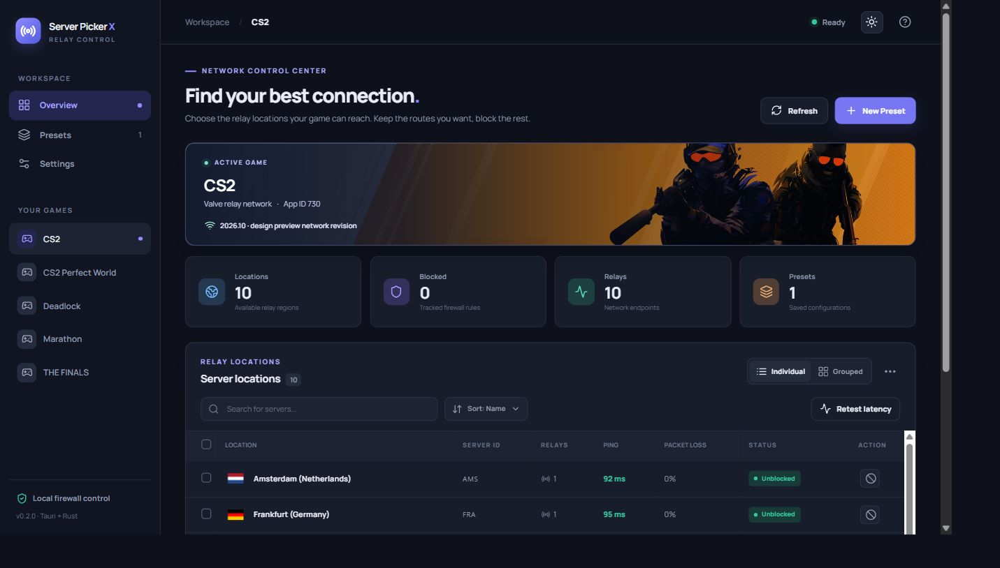

# Server Picker X

<div align="center">

<a href="https://github.com/Konohamaru04/server-picker-x-rust/releases"></a>


</div>

Lightweight server picker for CS2, Deadlock, and other configured games with cross-platform support for **Windows** and **Linux**. A rewrite of my CS2 Server Picker, now built with **Tauri 2, Rust, and React**. Designed to control connections by blocking or unblocking game relay locations.

## ⬇️ Download

### [Releases](https://github.com/Konohamaru04/server-picker-x-rust/releases)

If a Tauri release is not available yet, follow the build instructions below. Download only from a source you trust.

## 📷 Screenshot



_Current Tauri interface preview with sample relay and latency data. The desktop app loads live relay data._

<details>
  <summary>Previous Avalonia app demos</summary>

These recordings show the earlier app, not the current Tauri interface: [Windows demo](https://github.com/Konohamaru04/server-picker-x-rust/blob/4d5d353/readme_assets/ServerPickerX-Windows.gif) · [Linux Arch demo](https://github.com/Konohamaru04/server-picker-x-rust/blob/4d5d353/readme_assets/ServerPickerX-Linux-Arch.gif).
</details>

## ✨ What's new in this version

- The desktop app has moved from Avalonia to Tauri 2, with relay parsing, settings, and firewall controls in Rust and a redesigned React interface.
- CS2, CS2 Perfect World, Deadlock, Marathon, and THE FINALS are included. Additional games can be configured in `ServerDefinitions.json`.
- Latency and packet loss checks start automatically after relay data loads or the grouped view changes. **Retest latency** runs them again. Windows probes run without opening console windows.
- The active game banner uses bundled game artwork, so it also appears offline.
- Presets, selected game, language, and other compatible settings migrate from the old `settings.json` on first launch when that file is in the working directory.
- The GitHub workflow now builds and tests the Tauri app on Windows and Linux.

## ❔ FAQ

**1. How does it work, and will I get banned?**

- The app does not modify game files. It adds outbound firewall rules for selected game relay IP addresses. Game operators decide their own account policies, so this project cannot guarantee an outcome. Download only from trusted sources.

**2. Why am I not routed to the lowest-ping server, or why is filtering not working in my location?**

- The app can access and block **relay IP addresses**, not the game's actual server addresses. Steam Datagram Relay may choose another available route, and your location and ISP routing can affect the result. Re-routing can happen even during a match.
- To check the effect, leave a distant relay available while blocking a nearby one, then compare your in-game route. Avoid blocking too many relays. VPNs, other firewalls, or ISP routing can also affect results.

**3. Why does it require administrator or sudo permission?**

- Windows and Linux require elevated privileges to add or remove firewall rules. The Windows app requests elevation at launch. On Linux, use the provided launcher for a locally built executable: `bash RunServerPickerX.sh`.

**4. Why does Windows SmartScreen say the app is unrecognized?**

- Unsigned builds may show a publisher warning. Download from a trusted source or build it yourself using the instructions below. The [original SmartScreen example](https://github.com/FN-FAL113/csgo-server-picker/assets/88238718/fe0af8a8-4195-457e-bbbf-3a772e7f646c) is still relevant.

**5. Why do I receive frequent timeouts when a match is confirmed?**

- You may have blocked too many relay locations. Allow the necessary relays and try again.

## 🐛 Troubleshooting

| Problem                                                    | Possible cause                                                 | What to do                                                                                                       |
| ---------------------------------------------------------- | -------------------------------------------------------------- | ---------------------------------------------------------------------------------------------------------------- |
| Firewall rules are not applied                             | The app lacks elevated privileges                              | On Windows, approve the launch elevation prompt. On Linux, run `bash RunServerPickerX.sh` after building.        |
| No servers appear                                          | Network or relay source is unavailable                         | Check your connection and use **Refresh**.                                                                       |
| Latency is unavailable for every location                  | Probes or relay IPs are blocked                                | Check your connection, firewall, VPN, and whether the relays are reachable.                                      |
| A previously blocked relay remains blocked after migration | The old app's firewall rules were not recorded in its settings | Review and remove old `server_picker_x_` rules in your system firewall. The Tauri app clears only rules it owns. |

If you encounter a bug, [open an issue](https://github.com/Konohamaru04/server-picker-x-rust/issues) and include your operating system, steps to reproduce, and the error shown in the app. Do not post private settings or network details.

The app stores `settings.json` and `ServerDefinitions.json` in its per-user app config directory. It imports a legacy `./settings.json` once if one is present. Edit game definitions in the app config directory and restart the app; use the Settings UI for other preferences.

## 🛠️ Building from Source

Install [Rust](https://rustup.rs/), Node.js 22+, and the [Tauri 2 prerequisites](https://v2.tauri.app/start/prerequisites/) for your platform. On Linux, install `iptables` too. Build as a normal user; elevate only when running the app to manage firewall rules.

#### Clone the repo

```bash
git clone https://github.com/Konohamaru04/server-picker-x-rust.git
cd server-picker-x-rust
```

#### Install dependencies and run in development

```bash
npm ci
npm run tauri dev
```

#### Test and build

```bash
npm run build
cargo test --manifest-path src-tauri/Cargo.toml
npm run tauri build
```

The executable is written to `src-tauri/target/release/`; installers are written to `src-tauri/target/release/bundle/`. For an executable without an installer, run `npm run tauri build -- --no-bundle`. On Linux, launch a local release build with `bash RunServerPickerX.sh`.

For a browser-only interface preview with sample data, run `npm run dev` and open `http://localhost:1420/?demo=1`. This preview does not change firewall rules.

## 🔒 Firewall and migration notes

The app validates relay addresses before passing them directly to system firewall tools. New Windows rules use the `server_picker_x_v2_` prefix; Linux rules carry the same identifier in an `iptables` comment. **Clear app rules** removes only the rules tracked by this Tauri version and never resets the full firewall. Linux rules can disappear after a reboot; unblock and block a location again to refresh a stale record.

The previous app did not record its firewall rules in settings. Its existing Windows rules and earlier Linux rules need manual review before switching. Blocking relay IPs does not guarantee a particular in-game server, and blocking too many relays can cause matchmaking timeouts.

## 🤝 Contributing

Feel free to fork the repo, create a feature branch, and submit a pull request. All contributions are welcome; keep in mind the GPL v3 license. This project asks AI-generated pull requests to begin their title or description with `[AI-Generated]`.

## 🔽 Disclaimer

- This project and its author are not affiliated, associated, authorized, or endorsed by Valve, its affiliates, or subsidiaries. Game names and artwork belong to their respective owners.
- The banner images in `public/game-art/` come from the Steam store pages for [Counter-Strike 2](https://store.steampowered.com/app/730/CounterStrike_2/), [Deadlock](https://store.steampowered.com/app/1422450/Deadlock/), [Marathon](https://store.steampowered.com/app/3065800/Marathon/), and [THE FINALS](https://store.steampowered.com/app/2073850/THE_FINALS/). The GPL license for this app does not cover those images.
- You are free to compile the project yourself. Use trusted sources for any prebuilt downloads.

## 💖 Support the Project/Dev

- I develop stuff for free with dedication and hard work. Sharing this project with fellow gamers or giving it a star is a huge sign of appreciation!

<a href="https://www.paypal.com/paypalme/fnfal113" target="_blank">
  
</a>
